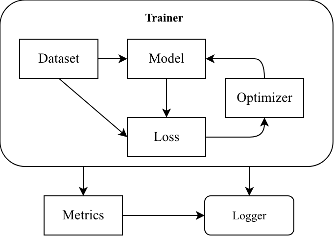

# \[Name\]

   \[Abstract\]

   Some teaser figures here. 
   


   Setup conda env. 
   ```
   # setting up uv
   uv venv --python=3.13

   # adding packages
   uv add numpy pandas matplotlib torch
   uv pip install -r requirements.txt
   ```

   Run example script to train MLP on MNIST. 
   ```
   python main.py --cfg=setup/cfg/mlp_mnist.yml
   ```

## Debugging

   Set `num_workers: 0` on every split in your config when running under a debugger, since
   debugpy attaches a separate debug session to each forked DataLoader worker and breakpoints
   in dataset code only land when that code runs in the main process.

# Hyperparameter Sweeps

   `sweep.py` drives [W&B sweeps](https://docs.wandb.ai/guides/sweeps). `main.py` deliberately takes only `--cfg`, so rather than passing sampled hyperparameters as arguments, each trial gets its own generated config file. A sweep spec names a base config and a search space over dot paths into it: 
   ```
   name: mlp_mnist_lr              # sweep name; also the subdirectory trial configs land in
   base_config: setup/cfg/mlp_mnist.yml
   entity: "your-entity"
   project: "ripe"

   method: bayes                   # grid | random | bayes
   metric:
     name: val.accuracy            # see the note on metric names below
     goal: maximize

   parameters:                     # keys are dot paths into the trial config
     run.optimizer.lr:
       distribution: log_uniform_values
       min: 1.0e-5
       max: 1.0e-2
     run.dataset.augmentation.rotation:
       values: [0, 10, 20]
   ```
   Put it in `setup/sweep/`, then create the sweep and run an agent in one go. You do not need the `wandb sweep` / `wandb agent` CLI; `sweep.py` calls the Python equivalents. 
   ```
   # create the sweep and run 10 trials
   python sweep.py --cfg setup/sweep/mlp_mnist_lr.yml --count 10

   # create it and print the id, without running anything
   python sweep.py --cfg setup/sweep/mlp_mnist_lr.yml

   # add another agent to an existing sweep (another terminal, or another machine)
   python sweep.py --cfg setup/sweep/mlp_mnist_lr.yml --id <sweep id> --count 10
   ```
   Trials run sequentially within one agent, so launch several agents against the same `--id` to parallelize.

## Time budgets

   Two flags bound a sweep by wall clock, both in fractional hours. W&B itself only caps the *number* of runs (`run_cap`), so these are enforced locally. 
   ```
   python sweep.py --cfg setup/sweep/resnet50_bioscan1m.yml --count 10 --trialtime 2
   ```
   - `--trialtime` stops each trial after N hours. The trial is sent SIGINT (then SIGKILL after a 60s grace period), so wandb still finalizes the run. Because `logger.save` writes metrics every epoch, every completed epoch survives; only the partial epoch is lost. A stopped trial reports success, so the agent keeps going.
   - `--walltime` stops the whole sweep after N hours. It is checked *between* trials, so the last trial can overrun by its own length — pair it with `--trialtime` to bound that.

   Either flag on its own is enough to start an agent; with `--count` as well, whichever limit is reached first wins.

## Running on one machine or many

   An *agent* is one `sweep.py` process that pulls configs from the sweep's queue and runs them one at a time. To parallelize, run more agents against the same sweep id. There are two ways to do that.

   ### A. Create the sweep and run it right away (one agent)

   With any of `--count`, `--walltime` or `--trialtime`, `sweep.py` creates the sweep and starts an agent in the same command:
   ```
   # stop after 8 hours total, and cap each trial at 2 hours
   python sweep.py --cfg setup/sweep/resnet50_bioscan1m.yml --walltime 8 --trialtime 2

   # or bound it by number of trials instead
   python sweep.py --cfg setup/sweep/resnet50_bioscan1m.yml --count 10 --trialtime 2
   ```
   `--trialtime` on its own does not start an agent; it only sets the per-trial limit, so pair it with `--count` or `--walltime`. Use this form on a single GPU. It still prints the sweep id, so you can add more agents later with the commands in section B.

   ### B. Create the sweep once, then run an agent on each of N nodes

   Use this when you have several interactive nodes, each with its own GPU (e.g. 6 nodes with one A5000 each).

   1. **Create the sweep once**, from any node or the login node. With no budget flag, this registers the sweep and prints its id without running anything:
      ```
      python sweep.py --cfg setup/sweep/resnet50_bioscan1m.yml
      # Created sweep: abc123xy
      ```
   2. **On each node**, run an agent against that id. Every node uses the same command:
      ```
      python sweep.py --cfg setup/sweep/resnet50_bioscan1m.yml --id abc123xy --walltime 8 --trialtime 2
      ```
      The agents pull different configs from W&B, so trials never overlap. Set `--walltime` to a little less than your node allocation so the agent stops cleanly before the node is reclaimed, and `--trialtime` so a single long trial can't run past it.

   Things to check for the multi-node case:
   - **`saved/` must be shared.** Every node writes into `saved/sweep-abc123xy/`, so the repo has to sit on a filesystem mounted on all nodes (here, `/usr/project/xtmp`). Trial directories are named by W&B run id, so nodes do not collide. Each agent re-copies the same `sweep.yml` and `base.yml` into the sweep directory, which is harmless because the contents are identical.
   - **One GPU per node.** Set `n_gpus: 1` in the base config. `main.py` then uses `cuda:0`, which is the node's only GPU.
   - **Several GPUs on one node.** Pin each agent to its own GPU with `CUDA_VISIBLE_DEVICES`, in a separate terminal or background job per GPU:
      ```
      CUDA_VISIBLE_DEVICES=0 python sweep.py --cfg ... --id abc123xy --walltime 8 &
      CUDA_VISIBLE_DEVICES=1 python sweep.py --cfg ... --id abc123xy --walltime 8 &
      ```
   - **Always pass `--id` on the extra nodes.** Without it, `sweep.py` creates a second, separate sweep.
   - **Budgets are per agent.** `--count` and `--walltime` bound one agent, not the whole sweep. Add `run_cap` to the spec to cap the total number of runs across all agents.
   - **Closing the sweep.** Agents ending does not close the sweep on the W&B side. Pass `--finish` to the last agent, or run `wandb sweep --stop <entity>/<project>/<id>`.

## Notes

   - **Metric names are flattened.** `trainer.metrics` is nested as `{"train": {...}, "val": {...}}`, but the wandb client preserves nesting rather than producing a single addressable key, so `Logger.save` flattens it to `train.accuracy`, `val.accuracy`, and so on. Your sweep's `metric.name` must match one of those flat keys.
   - **Trials always log to wandb.** `sweep.py` forces `log.wandb.enabled: True` and overwrites `entity`/`project` from the spec, since a sweep with no reported metric has nothing to optimize. `wandb login` must have been run.
   - **Where things land.** Everything a sweep produces is grouped under one directory, named for the wandb sweep id. Each trial is an ordinary run directory inside it, named for its wandb run id, so a run can be cross-referenced with the W&B UI by name.
   ```
   saved/sweep-<sweep id>/
     sweep.yml              copy of the spec this sweep was created from
     base.yml               copy of the base config it starts every trial from
     8cs782t4/              one per trial, laid out like any other run
       cfg.yml                this trial's resolved config
       stdout.txt
       0000/ 0001/ ...        metrics.json and checkpoints per epoch
       wandb/
     k2j9x1pq/
       ...
   ```
   A manual `--trial` invocation has no sweep id, so it falls back to `saved/sweep-<spec name>/` and still groups rather than scattering.
   - **Watch coupled parameters.** Do not sweep anything that another field has to agree with — `run.dataset.shape` must match `model.in_size`, and `run.dataset.rank` / `min_samples` change the class count that `model.num_classes` (or `dimensions[-1]`) encodes. Nothing validates this, so the run will fail partway in.
   - **Losses reduce by sum.** `CrossEntropy` uses `reduction='sum'`, so the gradient scales with batch size and a learning-rate range is only meaningful for a fixed `batch_size`. Rescale the range if you change it.

# Some Design Choices

   Here are some quick rues. 
   1. The dataloader should be collated to return a dictionary rather than tuples. This makes it more flexible to accommodate datasets that may have one, two, or more inputs. 
   2. Flattening data before forwarding into, say an MLP, should be done in the forward function of the `nn.Module` object. 

## Multiple Models/Optimizers/Losses

   If you need multiple models, either in the form of a model that contains a smaller model (such as a multimodal Prototree that contains an image and genetic unimodal prototrees), or multiple separate models (like a generator and discriminator for GANs) then you should create multiple instances under the relevant section. The same applies for losses and optimizers. 

   For example, in a GAN, we can change it to something like this. 
   ```
   model: 
     name: "gan" 
     generator: 
       hidden_dim: [64, 128, 256, 512]
       activations: ["relu", "relu", "relu", "sigmoid"]
     discriminator: 
       hidden_dim: [512, 256, 128] 
       activations: ["leaky_relu", "leaky_relu", "sigmoid"]
   ```
   Since these are two separate models, we can return a tuple of them 
   ```
   case "gan": 
     generator = Generator(**cfg_model["generator"]) 
     discriminator = Discriminator(**cfg_model["discriminator"]) 
   ```
   Or we can put them in a wrapper class called `GAN` or something, and then just return that 
   ```
   case "gan": 
     gan = GAN(**cfg_model)
   ```


   For example, for a multimodal prototree, 
   ```
   model:
     name: "prototree"
   ```
   would be changed to something like 
   ```
   model: 
     name: "multimodal_prototree" 
     depth: 11 
     image: 
       name: "image_prototree" 
       latent_dim: 2048
     genetic: 
       name: "genetic_prototree" 
       latent_dim: 64
   ```
   So when you actually call `init_model()`, you would add an extra case argument where the input dictionary argument provides all the keyword arguments needed to construct the unimodal image and genetic prototrees. 
   ```
   case "mmptree": 
     print("Loading Model: Multimodal ProtoTree")
     model = MultimodalProtoTree(**cfg_model)
   ```

   If you have multiple models/losses/optimizers, these will all have to be passed as arguments to the `Trainer` class. 
   ```
   train_dl, val_dl, test_dl = dataset.init_dataloader(cfg["dataset"])
   model = run.model.init_model(cfg["run"]["model"]).to(device)
   loss = run.loss.init_loss(cfg["run"]["loss"])
   optimizer = run.optimizer.init_optimizer(cfg["run"]["optimizer"], model)

   trainer = run.Trainer(train_dl, val_dl, test_dl, model, loss, optimizer, device=device)
   ```
   Therefore, the constructor signature will change quite a bit depending on which model you're implementing. I still need to think of a better way to design this, perhaps using a Builder Pattern. idk tho

## Logging distributions, image samples, etc. 

   Sometimes, you may want to see how the model's distribution evolves. All of these should be done in the logger. 

   All metrics that are floating point values (e.g. loss values, regularization values) should be saved every epoch. 
   All data that are tensors should be saved periodically (e.g. model weights, gradients)

   


